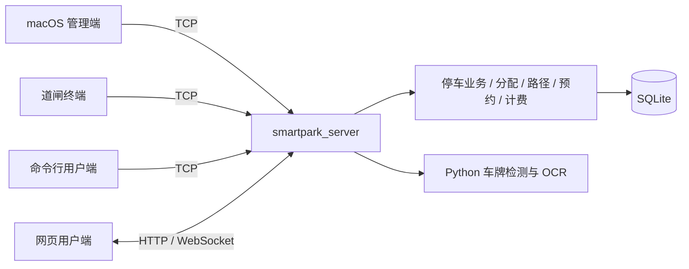

# SmartPark 智能停车场管理系统

SmartPark 是一个以 C++17 为核心的智能停车场管理系统课程项目，覆盖车位分配、路径规划、时段预约、停车计费、数据持久化和车牌识别。当前维护版本由 **macOS 原生管理端、统一服务端、网页用户端和出入口／用户终端**组成，可在本机独立演示，也可通过服务端让多个终端共享停车状态。

管理界面使用 AppKit；Qt 6 用于数据库和网络通信；停车数据保存在 SQLite 中。网页端为原生 HTML、CSS 和 JavaScript，无需 npm 构建。真实图片识牌已接入，支付和道闸硬件仍采用模拟实现。

## 应用与功能

| 应用 | 入口 | 当前用途 |
| --- | --- | --- |
| macOS 管理端 | [apps/macos](apps/macos/CMakeLists.txt) | 仪表盘、实时车位图、车辆入离场、预约管理、停车记录；支持本地与远程模式 |
| 统一服务端 | [apps/server](apps/server/main.cpp) | 统一处理停车业务，提供 TCP、REST、WebSocket、网页静态资源及图片识牌服务 |
| 网页用户端 | [apps/webclient](apps/webclient/index.html) | 扫码注册／登录与车牌绑定、余位查询、预约与取消、模拟缴费、停车记录、到场引导与反向寻车 |
| 道闸终端 | [apps/gate](apps/gate/main.cpp) | 手输车牌模拟出入口，支持车型选择、道闸状态机、故障模拟、离线缓存与重连补报 |
| 命令行用户端 | [apps/user](apps/user/main.cpp) | 查询余位、创建／取消时段预约，实时接收服务端事件 |

核心能力包括：

- **车位分配与路线规划**：支持多分区、多出入口、普通／无障碍／充电／VIP 车位和障碍物；结合入口距离、出口距离、拥堵、转弯与分区压力评分，提供加权分配和最近车位两种策略。栅格路径规划使用 A* 与多目标 Dijkstra。
- **时段预约**：校验提前量、预约时长与时间段冲突，延迟锁定物理车位，处理到场核销、取消退定金、爽约没收和离场抵扣。管理端表单、网页与用户终端统一使用 `Reservation` 模型。
- **停车计费与模拟缴费**：按免费时长和计费单元计算停车费；网页收银台提供订单、二维码、超时关闭及模拟确认支付，支付成功后结算离场。
- **多端同步与恢复**：TCP 和 REST 共用业务实例，事件同步到 TCP 客户端和 WebSocket；SQLite 保存停车记录、预约、定金及支付订单，支持重启恢复。道闸只移除服务端明确确认过的离线事件。
- **图片识牌与人工核对**：YOLO 检测车牌，四角透视矫正后交给 PP-OCRv5 识别；远程管理端和网页上传图片，由服务端执行推理。
- **运营统计**：车位占用、收入、车流和分区压力可视化；核心保留规则预测、趋势分析与哈希链审计实现。远程大模型分析目前仅有可注入的接口。

## 系统结构

联网模式下，停车业务和权威数据库由服务端统一持有：



macOS 本地模式直接调用同一套 C++ 核心，使用本机数据库；远程模式通过 `ParkingDataSource`／`RemoteDataSource` 获取服务端快照并提交操作。连接远程服务端即可参与网页、道闸和管理端的联动。

| 管理端能力 | 本地模式 | 远程模式 |
| --- | --- | --- |
| 车位图、车辆入离场、时段预约、停车记录 | 支持 | 支持，数据由服务端提供 |
| 图片识牌 | 本机 Python 环境执行 | 上传至服务端执行 |
| 布局编辑、分配策略切换 | 支持 | 布局由服务端 `--layout` 决定；客户端不提供修改入口 |
| 应急入场、在场车型更正 | 支持 | 当前协议未提供对应操作，界面禁用 |

## 构建与启动

以下命令均在仓库根目录执行。

### 依赖与构建预设

| 依赖 | 要求 |
| --- | --- |
| C++ 工具链 | 支持 C++17；macOS 管理端还需 Xcode Command Line Tools／Objective-C++ |
| CMake / Ninja | CMake ≥ 3.21；仓库预设使用 Ninja |
| Qt 6 | Core、Sql、Network、HttpServer、WebSockets；需提供 QSQLITE 驱动，现有脚本及 CI 使用 Qt 6.8.3 路径／版本 |
| Python / uv | 启用本地或服务端真实识牌时需要；两套锁定环境使用 Python 3.12 |

管理端使用原生 AppKit，当前构建不依赖 Qt Widgets。二维码 C++ 实现已随仓库提供；PaddleOCR 框架与训练数据需另外准备。

[CMakePresets.json](CMakePresets.json) 提供三套配置：

| 配置预设 | 输出目录 | 内容 |
| --- | --- | --- |
| `macos-debug` | `build/macos` | macOS 管理端、服务端、终端和测试 |
| `server-debug` | `build/server` | 服务端、终端和测试，关闭 AppKit 管理端 |
| `server-release` | `build/server-release` | Release 服务端和终端，关闭测试 |

### macOS 管理端

```bash
# QT_PREFIX 指向包含上述模块的 Qt 安装目录。
QT_PREFIX="$HOME/Qt/6.8.3/macos" scripts/build-macos.sh
scripts/run-macos.sh

# 连接已启动的服务端：预填远程地址和账号，密码在登录界面输入。
scripts/run-macos.sh --remote 127.0.0.1:9527 --user admin
```

[构建脚本](scripts/build-macos.sh) 会尝试通过 qmake、常用安装路径或 Homebrew 查找 Qt。默认输出为 `build/macos/apps/macos/smartpark_admin_macos.app`；构建和运行脚本均可通过 `BUILD_DIR` 指定其他构建目录。

需要分发包时，运行 [scripts/package-macos.sh](scripts/package-macos.sh) 一键产出带使用说明与 ad-hoc 签名的 DMG（输出至 `build/pack/`，如 `SmartParkAdmin-0.5.0-macOS-arm64.dmg`）；脚本自动完成 Release 构建、macdeployqt、裁剪非 QSQLITE 驱动与 GUI 类插件/framework、签名校验与冒烟启动（CI 里 `RUN_SMOKE=0` 跳过）。部署目标为 macOS 12（`CMAKE_OSX_DEPLOYMENT_TARGET`，写入 Info.plist 的 LSMinimumSystemVersion）。CI 在 macos-15／macos-26／macOS 27（`xcode-27` 预览镜像）与 ubuntu-24.04 上构建并跑测试，macos-26 任务同时上传 DMG 工件。

也可直接使用预设：

```bash
cmake --preset macos-debug -DCMAKE_PREFIX_PATH="$HOME/Qt/6.8.3/macos"
cmake --build --preset macos-debug --parallel 4
ctest --preset macos-tests
```

### 服务端与网页用户端

Linux 构建示例；在 macOS 上只构建服务端时，将 Qt 前缀换成对应的 `macos` 路径：

```bash
cmake --preset server-release \
    -DCMAKE_PREFIX_PATH="$HOME/Qt/6.8.3/gcc_64"
cmake --build --preset server-release --parallel 4

mkdir -p build/server-release/demo-data
build/server-release/apps/server/smartpark_server \
    --port 9527 --http-port 18080 --ws-port 18081 \
    --db build/server-release/demo-data/smartpark.db \
    --layout data/garage-6f.txt \
    --web-root apps/webclient --advertise 127.0.0.1
```

启动后，在本机打开 [网页用户端](http://127.0.0.1:18080/)；[服务信息接口](http://127.0.0.1:18080/api/v1/meta) 可用于检查服务配置。手机或其他电脑访问时，把 `--advertise` 改为客户端可达的服务器 IP／域名，使用启动横幅中的地址或二维码。

| 参数 | 用途 |
| --- | --- |
| `--port` | TCP 端口，默认 `9527` |
| `--http-port` | REST 和网页端口，默认 `8080`；上例显式使用 `18080` |
| `--ws-port` | 独立 WebSocket 端口，默认 `8081`；`0` 表示关闭推送 |
| `--db` | SQLite 文件路径；不传时使用平台用户数据目录 |
| `--layout` | 布局文件；不传时使用内置 60 车位布局 |
| `--web-root` | 网页静态目录；不传时不提供网页 |
| `--advertise` | 启动横幅和扫码地址使用的对外主机地址 |
| `--ws-public-url` | 反向代理／HTTPS 部署时指定外部 WebSocket 地址 |
| `--lpr-command` | 图片识牌命令模板，`%1` 替换为临时图片路径 |

新数据库初始化时提供 `admin`、`gate`、`user` 演示账号，默认口令均为 `smartpark`；已有账号不会自动重置。联网演示应让管理端连接服务端，本地独立模式与服务端使用不同数据库文件。

仓库的 s1 部署记录使用 `10.108.17.55`，TCP／HTTP／WebSocket 端口分别为 `9527`／`18080`／`18081`。可用 `scripts/run-macos.sh --remote 10.108.17.55:9527 --user admin` 连接；该地址需具备集群内网访问条件。部署细节见 [服务器部署说明](docs/deploy-server.md)，当前构建参数以本页和 CMake 预设为准。

### 出入口与命令行用户端

另开终端连接上面的服务端：

```bash
# 入口；出口将 --mode 改为 exit。
build/server-release/apps/gate/smartpark_gate \
    --host 127.0.0.1 --port 9527 \
    --user gate --pass smartpark --mode entrance

# 命令行用户端。
build/server-release/apps/user/smartpark_user \
    --host 127.0.0.1 --port 9527 --user user --pass smartpark
```

道闸终端输入车牌并回车即可模拟入场／离场；`type electric` 等命令切换车型，`pass` 模拟车辆通过，`fault on|off` 模拟故障。入口与出口默认各用一份 JSONL 离线队列，也可通过 `--queue` 指定路径；断网时先将事件落盘，再模拟放行，重连后补报。

用户终端支持 `status`、`reserve <车牌> [开始偏移分钟] [时长分钟]`、`cancel <车牌>`。例如 `reserve 晋A12345 60 120` 表示预约一小时后开始、持续两小时的停车时段。两种终端均可输入 `help` 查看命令。

## 布局与业务规则

### 停车场布局

| 布局 | 规模与用途 |
| --- | --- |
| 内置基础布局 | 60 车位；服务端不传 `--layout` 时使用 |
| [garage-6f.txt](data/garage-6f.txt) | 58 × 42.4 米、75 车位；六层车库平面，双入口、单出口，包含多种车位与楼梯间障碍 |
| [garage-3tower.txt](data/garage-3tower.txt) | 190 × 88 米、335 车位；按 CAD 图纸重建的三塔楼地库，10 个车位分区、多出入口与核心筒障碍 |

三塔楼布局的 [预览图](garage-3tower-preview.png) 与 [图纸对照图](garage-3tower-vs-drawing.png) 位于仓库根目录。服务端可替换 `--layout` 加载，macOS 本地模式可在“设施配置”中导入或编辑。

布局文本以米为单位，支持 `site`、`entrance`、`exit`、`region` 和 `obstacle`。`region` 可设置行列数、车位尺寸、通道宽度、通道方向及车位类型，具体格式可参考上述样例。数据库保存布局签名；已有数据与新布局不匹配时会报错，服务端不会自动清空数据。

### 时段预约

当前默认规则见 [Reservation.h](src/core/model/Reservation.h)：

| 规则 | 默认值 |
| --- | --- |
| 最远预约时间 | 未来 7 天 |
| 最短提前量 / 最短时长 | 30 分钟 / 30 分钟 |
| 到场窗口 | 创建预约后即刻 至 开始后 30 分钟 |
| 物理锁位开始 | 预约创建时（立即锁位） |
| 预约定金 | 20 元，模拟收取 |

同一车牌只允许一笔未结束的时段预约，同一车位可以接受互不重叠的预约。成功创建后返回车位与预期入场／出场路线；预约一创建就锁住物理车位（管理端显示为“已预约”），到场窗口同时也从这一刻打开，最晚可到开始后 30 分钟。

到场核销转为实际停车，离场时定金抵扣停车费；允许取消的订单退回定金，超过宽限期未到场则判定爽约并没收定金。旧 `Booking` 模型及其数据仍用于历史兼容，管理端以“预约(历史)”区分展示，新表单统一创建 `Reservation`。

### 停车计费

默认免费 30 分钟，超出部分按 30 分钟单元向上取整；首单元 2.5 元，后续每单元 2.5 元，**单次停车费用封顶 100 元**。实现见 [BillingService](src/core/service/Billing.cpp)。例如停车 30 分钟为 0 元，31 分钟为 2.5 元，61 分钟为 5 元。

网页缴费使用模拟支付订单。预约定金在创建预约时收取，停车费订单在用户确认模拟支付后完成离场结算；未接入微信／支付宝真实支付，也不提供无感支付。

## 车牌识别

当前默认流程为 **YOLO pose 四角检测 → 透视矫正裁剪 → PP-OCRv5 字符识别**。缺少 pose 权重时可回退到轴对齐框检测；识别器优先使用部署目录中已有的省份均衡权重，否则使用仓库提供的基础权重。训练与推理共用 [裁剪几何实现](scripts/plate_geometry.py) 和裁剪配方。

- macOS 远程模式与网页端由服务端识别，客户端无需安装模型环境。服务端未配置 `--lpr-command` 时返回 `backend=mock` 的演示结果，配置真实脚本后返回 `backend=script`。
- macOS 本地模式使用检测和 OCR 两套 Python 环境；`SMARTPARK_LPR_PY`、`SMARTPARK_OCR_PY` 可覆盖解释器，`SMARTPARK_LPR_SCRIPT` 可覆盖本地识别脚本路径。
- 管理端先展示候选车牌，人工核对并采用后填入输入框，入场／出场另行操作。道闸终端目前仍用手输车牌模拟识别。

准备好 PaddleOCR 源码和模型实体后，可在 macOS 上验证单张图片：

```bash
# 需要 uv；同步 scripts/lpr 与 scripts/ocr 的锁定依赖。
scripts/setup_uv_env.sh

YOLO_OFFLINE=true "$HOME/.smartpark/lpr/bin/python" -B scripts/recognize_plate.py \
    examples/plates/blue-01.jpg \
    --ocr-python "$HOME/.smartpark/ocr/bin/python"
```

仓库权重通过 Git LFS 分发；仅编译与模拟演示不需要下载权重，真实识别需要确认本地文件是模型实体。`third_party/PaddleOCR` 不随仓库分发，需另外准备，也可通过脚本的 `--paddleocr` 指定。使用本地权重时设置 `YOLO_OFFLINE=true`，避免离线环境中的网络探测等待；[运行脚本](scripts/run-macos.sh) 已默认设置。

环境配置、服务端命令、训练入口及历史评测见 [车牌识别说明](docs/lpr.md)，样例来源见 [样例说明](examples/plates/README.md)。历史评测包含特定样本集与数据重叠限制；单张识别成功或高置信度不能替代独立测试集的准确率。2026-10-12 把评测集中 9 张识别失败的样本替换为 9 张全新 CCPD 样本并重测（替换后 200 张 199/200，s1 与本机一致），替换协议、失败原因与新样本来源见 [评测集替换记录](docs/lpr-eval-replacements-20261012.md)——这属于选择性替换，不能与替换前的 95.5% 直接比较。

## 测试与验证

```bash
# 服务端与终端测试；macOS 上也可使用此预设，Qt 前缀按平台替换。
cmake --preset server-debug -DCMAKE_PREFIX_PATH="/path/to/Qt"
cmake --build --preset server-debug --parallel 4
ctest --preset server-tests

# macOS 管理端测试（先完成 macos-debug 构建）。
ctest --preset macos-tests

# 连已有服务端验证管理端远程连接，默认只读。
build/macos/tests/smartpark_macos_remote_tests \
    --remote 10.108.17.55 9527 admin smartpark
```

CTest 覆盖核心模型、分配与计费、预约生命周期、服务端自测、道闸状态机及断线补报、识牌脚本、裁剪几何和数据准备逻辑。安装 Python 时注册相关脚本测试；缺少 NumPy／OpenCV 时部分视觉用例会跳过。

REST 端到端测试使用独立临时数据库并启动真实服务端进程，带 `e2e` 标签；macOS 构建另含地图和原生管理端远程测试。可用 `ctest --test-dir build/server -LE e2e --output-on-failure` 只运行非端到端用例。测试入口与条件见 [tests/CMakeLists.txt](tests/CMakeLists.txt)。

[CI 配置](.github/workflows/macos-server.yml) 在 macOS 和 Ubuntu 上构建当前应用并运行测试。测试数量随平台、依赖与构建选项变化，以当前 CTest 输出为准。

## 目录与进一步阅读

```text
apps/
  macos/       AppKit 管理端与本地／远程数据桥接
  server/      统一服务端
  webclient/   无需构建的网页用户端
  gate/        出入口模拟终端与离线队列
  user/        命令行用户端
src/
  core/        模型、业务服务、分配／路径算法与 SQLite 持久化
  network/     TCP 协议、会话、REST、WebSocket 与识牌后端
data/          停车场布局文本
scripts/       构建运行、识牌推理、数据准备、训练及评测脚本
model/weights/ Git LFS 模型权重与配套配置
examples/      车牌样例和来源清单
tests/         C++、Objective-C++、Python 与端到端测试
docs/          协议、部署、识牌及调研说明
third_party/   随仓库提供的二维码依赖；本机另行准备的训练框架
```

进一步阅读：[TCP 协议](docs/tcp-protocol.md)、[REST／WebSocket API](docs/rest-api.md)、[服务器部署](docs/deploy-server.md)、[车牌识别](docs/lpr.md)、[调研来源](docs/research-sources.md)。[handoff.md](handoff.md) 保留会话交接和历史验证记录，其中的旧分支、进程、命令与测试数量需结合当前源码判断。

旧 Qt Widgets 管理端、独立演示 CLI、专属测试和 Windows 启动脚本已保存到 `archive/legacy-apps-20261009` 分支，当前工作树维护上述五个应用。需要查看旧实现时，可单独检出归档：

```bash
git worktree add ../smartpark-legacy archive/legacy-apps-20261009
```

本地构建产物、数据库、训练框架／数据／输出和会话文件按 [.gitignore](.gitignore) 排除；这些本机文件并不等同于仓库随附的运行依赖。
