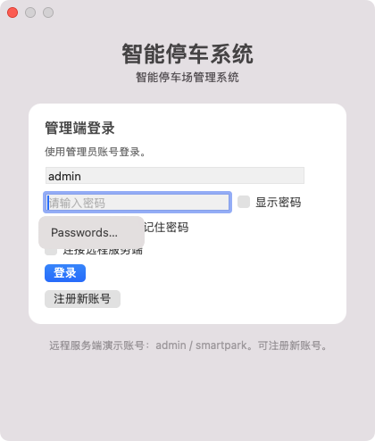
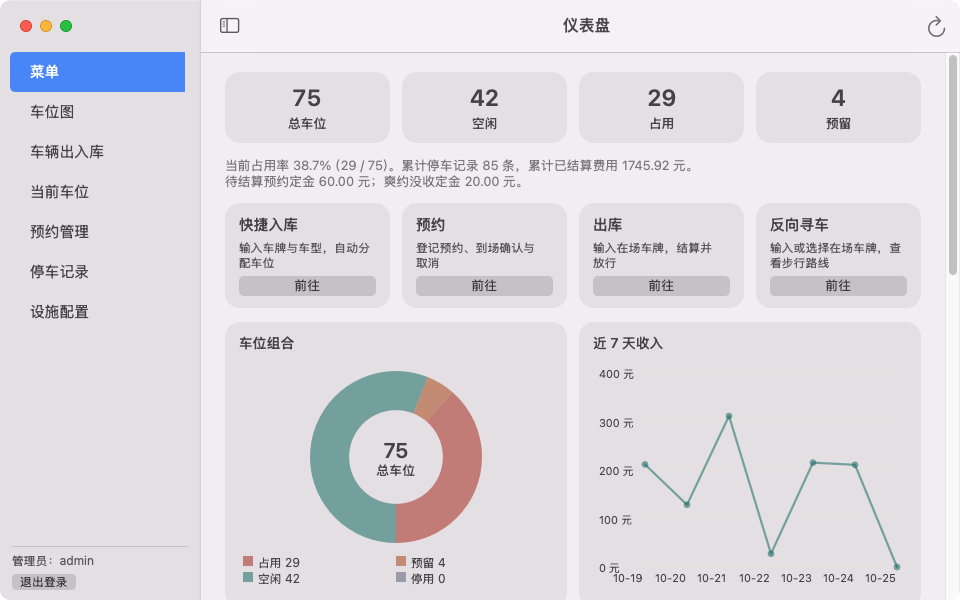
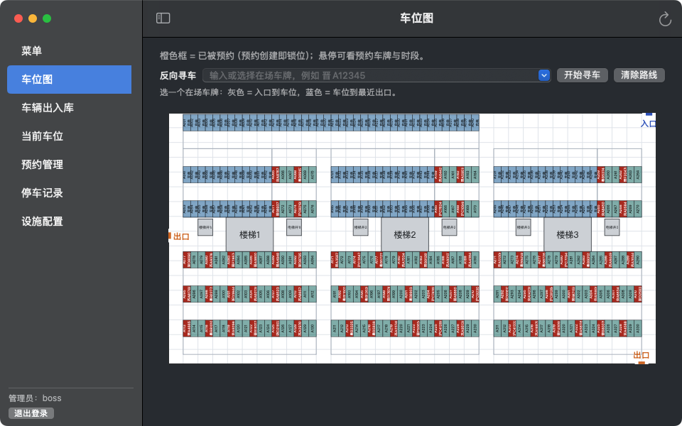
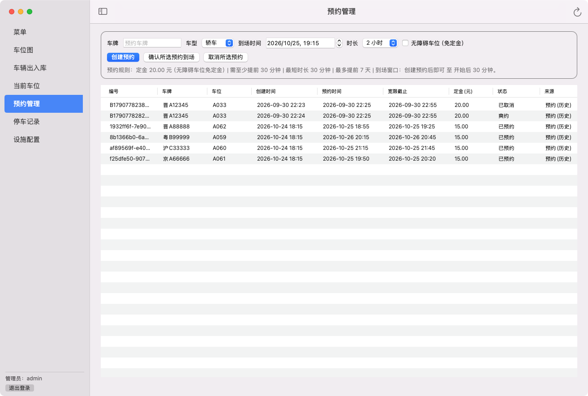
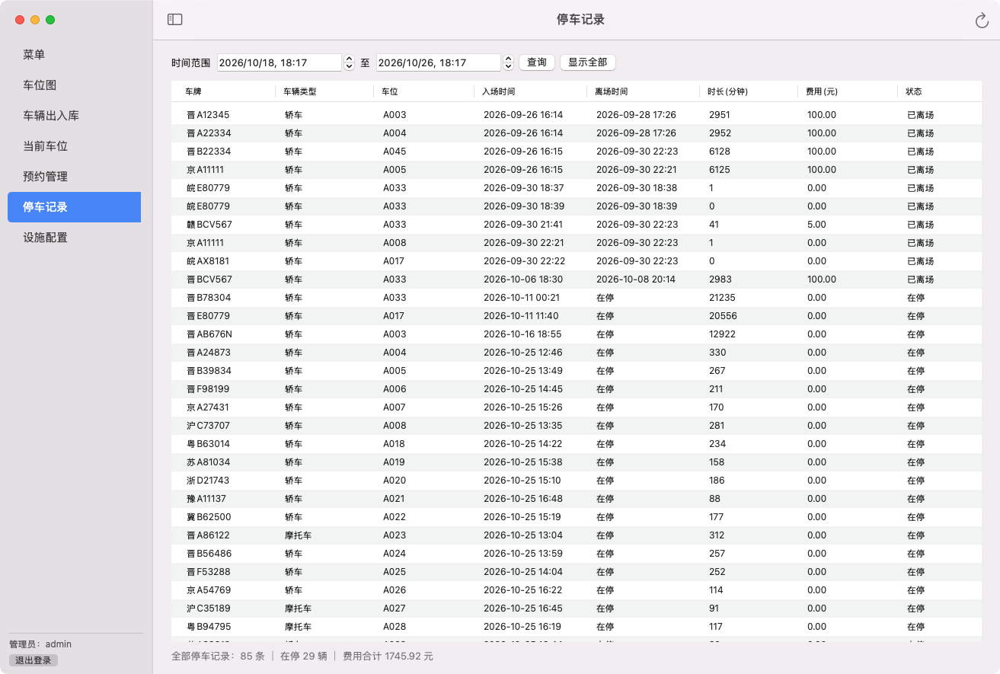
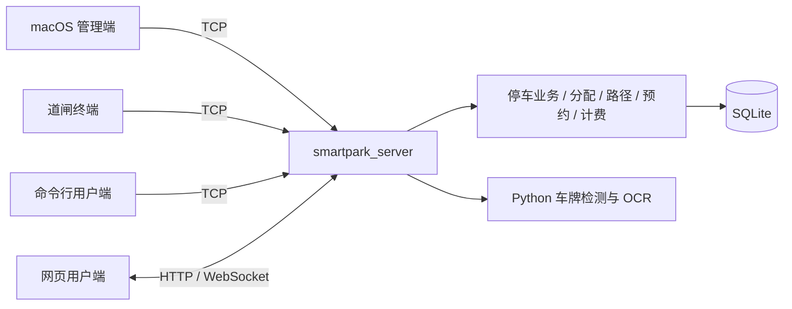

# SmartPark 智能停车场管理系统

[](https://github.com/cadetcarrington/Cpp-CourseProject_smart_park/actions/workflows/macos-server.yml)
[](https://github.com/cadetcarrington/Cpp-CourseProject_smart_park/releases)

SmartPark 是一套以 C++17 为核心的智能停车场管理系统（C++ 课程设计）。服务端统一持有停车业务与 SQLite 权威数据，通过 TCP、REST 和 WebSocket 同时服务 macOS 原生管理端、H5 网页用户端、道闸终端与命令行用户端；管理端为 AppKit 原生界面（Qt 6 只负责数据库与网络），网页端为零构建的原生 HTML/CSS/JavaScript。车牌识别接入 YOLO 检测 + PaddleOCR，属于可选项，未配置时车牌改为人工输入，不影响其余功能。支付与道闸硬件为模拟实现。

## 截图

| 首次启动注册 | 登录页 |
|:---:|:---:|
|  |  |
| **仪表盘** | **车位图（330 位三塔楼地库）** |
|  |  |
| **预约管理** | **停车记录** |
|  |  |

## 功能特性

- **首次启动注册**：管理端账号库为空时，第一次打开自动弹出「创建管理员账号」注册页，注册成功后账号名回填登录框；之后每次启动都是正常登录页（[LoginViewController.mm](apps/macos/LoginViewController.mm)）。
- **macOS 26/27 设计适配**：登录与注册卡片在 macOS 26（Tahoe）上采用 Liquid Glass 液态玻璃，「登录」「注册账号」主按钮为独立玻璃胶囊；macOS 27（Golden Gate）上卡片与胶囊升级为官方交互玻璃（`effectIsInteractive`，按压反馈由系统提供），停车记录页支持**下拉刷新**（`NSRefreshController`，与 ⌘R 同一条数据路径）（[GlassUI.mm](apps/macos/GlassUI.mm)、[TableView.mm](apps/macos/TableView.mm)）；macOS 12–15 保持原有 NSVisualEffectView 外观，观感零变化。
- **两套内置车库布局**：75 位六层车库（[data/garage-6f.txt](data/garage-6f.txt)，58 × 42.4 米，双入口单出口）与按 CAD 图纸重建的 330 位三塔楼地库（[data/garage-3tower.txt](data/garage-3tower.txt)，165 × 85 米，10 个车位分区、1 入口 2 出口）；车位分配按分区负载、入口/出口距离、拥堵与转弯次数加权评分，也可切换最近车位策略（[SpotAllocator](src/core/service/SpotAllocator.cpp)、[GridPlanner](src/core/service/GridPlanner.cpp)，路径规划用 A* 与多目标 Dijkstra）。
- **识别即办理的出入库**：出入库页选择车牌照片，本机识别后置信度达标（默认 0.85）直接入场/出场，读不准时弹一次人工确认；绿牌自动把车辆类型记为电动车（[OperationsViewController.mm](apps/macos/OperationsViewController.mm)）。
- **时段预约**：校验提前量与时长冲突、创建即锁定物理车位、到场核销、取消退定金、爽约没收、离场抵扣定金；管理端表单、网页与命令行共用同一 `Reservation` 模型（[ReservationService](src/core/service/ReservationService.cpp)）。
- **停车计费与模拟缴费**：免费 30 分钟，之后每 30 分钟 2.5 元向上取整，单次封顶 100 元（[Billing.cpp](src/core/service/Billing.cpp)）；网页收银台提供订单、二维码与模拟确认支付，支付成功后结算离场。
- **多端同步与恢复**：TCP 与 REST 共用业务实例，事件推送到 TCP 客户端和 WebSocket；SQLite 保存停车记录、预约、定金与支付订单，重启恢复；道闸终端断网时事件落盘、重连补报，只移除服务端确认过的事件。
- **账号安全**：口令使用 16 字节随机盐加迭代 SHA-256 存储（[UserStore.cpp](src/core/service/UserStore.cpp)）。

## 快速开始

### 方式一：下载 DMG（推荐，macOS 12+ Apple Silicon）

1. 从 [Releases](https://github.com/cadetcarrington/Cpp-CourseProject_smart_park/releases) 下载 `SmartParkAdmin-0.5.0-macOS-arm64.dmg`（约 10 MB）。
2. 打开镜像，把 **SmartPark Admin** 拖入 Applications（镜像内含指向 `/Applications` 的替身和一份使用说明）。
3. 首次启动会自动弹出「创建管理员账号」，注册成功后账号回填，输入口令登录；之后每次打开都是正常登录页。
4. （可选）登录页勾选远程模式，填入服务端地址（如 `127.0.0.1:9527`）与账号连接服务端，与网页端、道闸终端联动；不连接则按本地模式独立运行。

应用为 ad-hoc 签名、未公证，被 Gatekeeper 拦截时右键选择「打开」，或执行：

```bash
xattr -cr "/Applications/SmartPark Admin.app"
```

### 方式二：源码构建

依赖：支持 C++17 的工具链、CMake ≥ 3.21（预设用 Ninja）、Qt 6.8（最低 6.2；Core / Sql / Network / HttpServer / WebSockets，含 QSQLITE 驱动）。macOS 管理端另需 Xcode Command Line Tools。

```bash
# macOS 管理端（QT_PREFIX 指向 Qt 安装目录；输出 build/macos/apps/macos/smartpark_admin_macos.app）
QT_PREFIX="$HOME/Qt/6.8.3/macos" scripts/build-macos.sh
scripts/run-macos.sh

# 服务端（Linux 或 macOS）；Qt 前缀按平台选择：
# Linux 一般是 $HOME/Qt/6.8.3/gcc_64，macOS 是 $HOME/Qt/6.8.3/macos
QT_PREFIX="$HOME/Qt/6.8.3/gcc_64"    # macOS 改为 "$HOME/Qt/6.8.3/macos"
cmake --preset server-release -DCMAKE_PREFIX_PATH="$QT_PREFIX"
cmake --build --preset server-release --parallel 4

mkdir -p build/server-release/demo-data
build/server-release/apps/server/smartpark_server \
    --port 9527 --http-port 18080 --ws-port 18081 \
    --db build/server-release/demo-data/smartpark.db \
    --layout data/garage-3tower.txt \
    --web-root apps/webclient --advertise 127.0.0.1
```

新数据库初始化时提供 `admin`、`gate`、`user` 演示账号，默认口令均为 `smartpark`（已有账号不会自动重置）。服务端默认参数：`--port 9527`（TCP）、`--http-port 8080`、`--ws-port 8081`，上例沿用部署常用的 18080/18081。手机访问时把 `--advertise` 改为局域网 IP。

另开终端接入出入口与命令行用户端：

```bash
# 道闸终端；出口把 --mode 改为 exit，输入车牌回车即模拟出入场
build/server-release/apps/gate/smartpark_gate \
    --host 127.0.0.1 --port 9527 --user gate --pass smartpark --mode entrance

# 命令行用户端；支持 status / reserve / cancel，输入 help 查看命令
build/server-release/apps/user/smartpark_user \
    --host 127.0.0.1 --port 9527 --user user --pass smartpark
```

需要分发时，[scripts/package-macos.sh](scripts/package-macos.sh) 一键完成 Release 构建、macdeployqt、裁剪非必需插件、ad-hoc 签名与冒烟验证，在 `build/pack/` 产出带使用说明和 `/Applications` 替身的 DMG；CI 的 macos-26 任务同样上传 DMG 工件。

## H5 网页用户端

[apps/webclient](apps/webclient/index.html) 为原生 HTML/CSS/JavaScript，无 npm、无构建步骤，由服务端 `--web-root` 直接托管。启动服务端后打开 `http://<服务器地址>:18080/`（[服务信息接口](http://127.0.0.1:18080/api/v1/meta) 可检查配置），功能包括：

- 扫码注册/登录与车牌绑定（服务端侧演示账号 `admin` / `smartpark`）
- 余位查询、时段预约与取消
- 模拟缴费收银台（订单、二维码、超时关闭）
- 停车记录、到场引导与反向寻车

## 车牌识别（可选）

默认流程为 **YOLO pose 四角检测 → 透视矫正裁剪 → PP-OCRv5 字符识别**，单图命令行调用见 [scripts/recognize_plate.py](scripts/recognize_plate.py)。

- **环境是可选的**：检测与 OCR 分别使用两套由 uv 同步的锁定 Python 环境（[scripts/setup_uv_env.sh](scripts/setup_uv_env.sh)），解释器位于 `~/.smartpark/lpr/bin/python` 与 `~/.smartpark/ocr/bin/python`。环境缺失时管理端会明确提示，车牌改为手工输入，不返回模拟结果，其余功能完全不受影响。
- **低置信度人工确认**：识别置信度低于阈值（默认 0.85）或结果无效时弹出人工确认，确认后才填入输入框办理。
- **服务端识别**：网页端上传图片由服务端推理，需配置 `--lpr-command`（`%1` 替换为临时图片路径）；未配置时返回 `backend=mock` 的演示结果。

环境配置、训练与评测细节见 [docs/lpr.md](docs/lpr.md)。仓库权重经 Git LFS 分发，仅编译与模拟演示不需要下载权重。

## 架构与技术栈



| 层 | 技术 |
| --- | --- |
| 核心业务 | C++17：车位分配、A* / Dijkstra 路径规划、预约、计费、审计 |
| 管理端 | macOS 12+ AppKit 原生界面（不依赖 Qt Widgets），本地/远程双模式 |
| 服务端 | Qt 6.8（Core / Sql / Network / HttpServer / WebSockets）；TCP 9527 + REST/网页 + WebSocket 网关 |
| 存储 | SQLite 单文件库（QSQLITE），含布局签名校验与重启恢复 |
| 网页用户端 | vanilla HTML/CSS/JavaScript，零构建 |
| 车牌识别 | Python 3.12 + uv 锁定环境，YOLO 检测 + PaddleOCR（可选） |

测试：`ctest --preset server-tests`（服务端与终端）、`ctest --preset macos-tests`（管理端），覆盖核心模型、分配计费、预约生命周期、道闸离线补报、REST 端到端等。CI（[macos-server.yml](.github/workflows/macos-server.yml)）在 macos-15、macos-26、xcode-27（macOS 27 预览）与 ubuntu-24.04 四个镜像上编译并运行 ctest。

## 文档索引

| 文档 | 内容 |
| --- | --- |
| [docs/rest-api.md](docs/rest-api.md) | REST / WebSocket API 协议 |
| [docs/tcp-protocol.md](docs/tcp-protocol.md) | TCP 终端协议 |
| [docs/deploy-server.md](docs/deploy-server.md) | 服务端部署说明 |
| [docs/lpr.md](docs/lpr.md) | 车牌识别：运行、训练与评测 |
| [docs/research-sources.md](docs/research-sources.md) | 调研来源 |

## 许可证

本仓库暂未附带开源许可证文件（课程设计作品，版权保留）；正式对外发布前会在此补充许可证条款。
